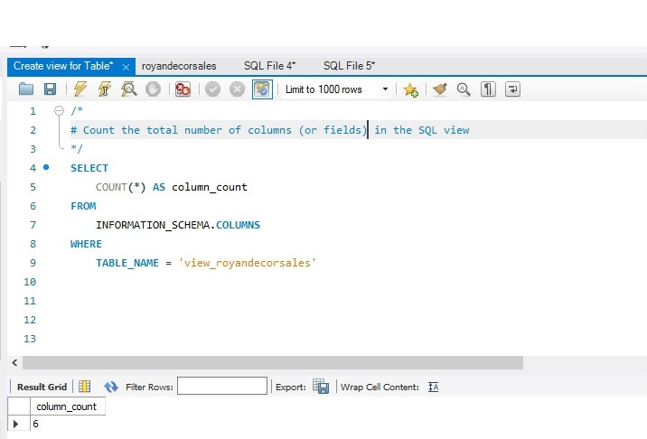
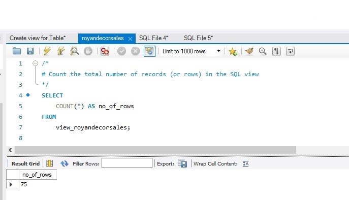
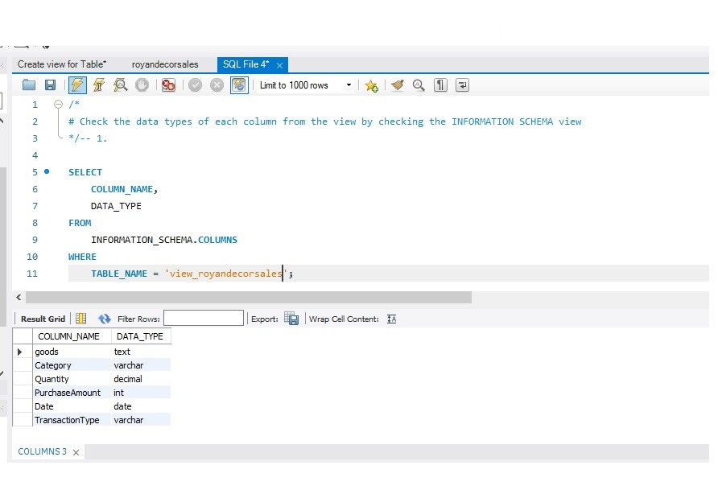
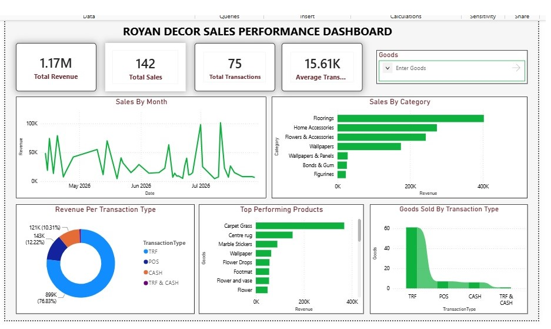
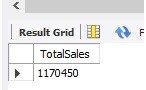
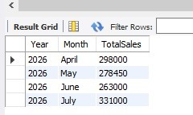
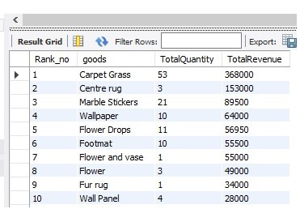
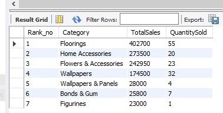

# Royan Décor Sales Performance Analysis

#### Product Restocking and Payment Method Insights
##### DESCRIPTION:
An end-to-end data analytics project using Excel, SQL, and Power BI to identify top-performing products, evaluate payment methods, and provide actionable recommendations for inventory management and business decision-making.

 

## TABLE OF CONTENTS 
#### Project Definition
- Evaluation of Business Problem / Question
- Objective
- Key Performance Indicators (KPIs)

#### Data Identification 
- Data Requirements & Sources 
- Availability & Compliance Checks
- Data Exploration

#### Data Acquisition & Preparation
- Collection & Extraction
- Data Cleaning
- Data Validation & Quality Checks 

#### Visualization
- Results
- DAX Measures

#### Analysis & Insight Generation
- Exploratory Data Analysis
- Discovery

#### Recommendations
- Potential Courses of Action
- Estimated ROI & Business Impact 

#### Conclusion

 

## PROJECT DEFINITION

### EVALUATION OF BUSINESS PROBLEM / QUESTION
<ins>What is the key point?</ins>

The CEO of Royan Décor wants to restock her store, but she’s not sure on which products she should prioritize on. And she has a very limited budget to work with. So, she sent her sales record which was handwritten into a journal in a picture format. This was entered into Excel to create A SALES RECORD. The record contains only records of sales from 14th of April till 28th July, when this analysis was carried out.
She also has an issue with her POS machine and she wants to know if it’s worth getting in order, and it depends on usage frequency.

Simply put, she wants to find out;
- Which products should be restocked?
- Should the company keep or remove the POS payment method?

Expansively;
- What is the total sales?
- What is the total revenue generated?
- What are the total sales per month?
- Which products are the top performing products?
- How effective are the transaction types?
- Which product segment (Category) responded best? 
- Which product had the best balance between sales and profit?

We will be working on this project with these questions in mind.

### OBJECTIVE
Therefore, our objective is:
Analyze Royan Décor sales data to identify high-performing products and evaluate the effectiveness of different payment methods to support inventory and business decisions.

### KEY PERFORMANCE INDICATORS (KPIS)
To understand the how well the business has performed, the products that need to be restocked and the effectiveness of the payment methods, we will be looking at the following KPIs;
-	Total sales
-	Total Revenue 
-	Average sales and revenues
-	Transaction types

 

## DATA IDENTIFICATION

### DATA REQUIREMENTS & SOURCE 
What is needed to achieve our objective? This will determine our data source.
Since it is within the company, we will need the company’s Sales Data (Sales Record) that includes:
- Total Sales
- Total Profit
- List of products; and 
- Transactions and types

The data source is a first party data received from Royan Décor.

### AVAILABILTY & COMPLIANCE CHECKS
<ins>Availability Check</ins>

The required sales data was available for analysis and contained the key fields necessary to evaluate Royan Decor's sales performance. The dataset included information relating to sales dates, products, categories, transaction types, quantities/goods sold, and revenue. These fields provided sufficient information to analyze revenue trends, product performance, category performance, and transaction-type performance.

The available data was also suitable for integration into Power BI for visualization and dashboard development. However, additional financial information such as product cost, operating expenses, and profit margins was not available. Therefore, the analysis focused primarily on revenue and sales performance, while precise profitability and ROI calculations were not established.
 

| Check                        | Findings       |
| ---------------------------- | -------------- |
| Sales data available         | Yes            |
| Product information          | Available      | 
| Category information         | Available      |  
| Transaction type             | Available      | 
| Sales/revenue                | Available      |
| Date information             | Available      |
| Quantity/goods sold          | Available      | 
| Cost/profit information      | Not Available  | 
| Data suitable for Power BI   | Yes            | 

 

#### Compliance Check

This is about checking whether the data follows the required business rules, data standards, and reporting requirements.

The dataset was reviewed against the defined business and data-quality requirements before analysis. Data fields were checked for appropriate formats, consistency, completeness, duplicate records, and valid categorical values. Transaction types were reviewed to ensure that they followed the expected classifications, while dates, quantities, and revenue values were checked for appropriate formats and reasonable values.

The analysis also ensured that the dashboard calculations were based on the validated dataset and that the reporting period was consistent with the available sales records. Any data-quality issues identified during validation were addressed before the data was used for the final analysis.

| Compliance Check                       | What was checked      |
| ---------------------------- | -------------- |
| Data types	| Dates, numbers and text stored correctly |
| Missing values	| Checked important fields for blanks |
| Duplicates	| Checked for duplicate transactions |
| Dates	| Checked that dates were valid and within the analysis period |
| Revenue	| Checked that revenue values were numeric and reasonable |
| Quantity	| Checked that goods sold values were valid |
| Transaction type	| Checked TRF, POS, CASH and TRF & CASH classifications |
| Categories	| Checked that products were assigned to appropriate categories |
| Consistency	| Checked naming and formatting consistency |
| Calculations	| Cross-checked dashboard measures against source data |
 
 

### DATA EXPLORATION

Data Exploration Notes

- The data contains 76 rows and 8 columns.
- There were 35 blank columns in the “Description” Column which is to be left blank since there’s no description available for it.
- There’s no duplicate transaction(s) found in the dataset (since it was manually recorded).
- The “description” is not necessary and would be removed.
- There are some columns that are not in the right format, they’ll need to be addressed.
- The transaction types include the following types of transactions;
  -	TRF – transactions sent via electronic bank transfer
  -	POS – transactions performed using a debit card
  -	CASH – transactions completed with physical cash

## DATA ACQUISITION & PREPARATION
### COLLECTION & EXTRACTION
<ins>Tools Used</ins>

**Microsoft Excel** was used to;
- Record the data
- Explore the data
- Format some certain columns in order to properly import the dataset into SQL.

**SQL** was used to;
- Clean, test and analyze the data

**Power BI** was used to visualize the data via interactive dashboards

**GitHub** was used to host the project.

### DATA CLEANING
- We tried to import the data into SQL workbench but we ran into an issue so we had to format some certain data in the “Purchase Amount” column. The data was converted to CSV file and was successfully imported into MySQL workbench.
- Changed the data type of the columns in our database to the right formats.

       alter table royandecorsales
       modify column category varchar(100),
       modify column Quantity decimal (10, 2),
       modify column Measure varchar(100),
       modify column purchaseamount int,
       modify column date date,
       modify column transactiontype varchar(100)

- The “description” and “measure” columns as they won’t be needed for this analysis. And this was done by pulling up the columns we needed in the database;

      select 
          goods,
          quantity,
          Purchaseamount,
          date,
          transactiontype
       from 
          royandecorsales

- Checked for blanks in the work book;

      select *
      From royandecorsales
      where goods is null
         or quantity is null
         or purchaseamount is null

- Removed any space within the goods column that might affect our analysis.

      update royandecorsales
      set goods = trim(goods);

CREATE A VIEW TO STORE THE TRANSFORMED

      /*
      #1. Create a view to store the transformed data
      #2. Select the required columns from the royandecorsales SQL table 
      */
      
      -- 1.
      CREATE VIEW view_royandecorsales AS
      -- 2.
      SELECT
          goods,
          Category,
          Quantity,
          PurchaseAmount,
          Date,
          TransactionType
      
      
      FROM
          Royandecorsales

### DATA VALIDATION & QUALITY CHECK

What tests do we need to validate our data sets?

To continue this analysis, we need to be sure that our data meets the requirements to generate the insights we need.
We will be carrying out the following data tests;
1.	Column count check
2.	Row count check
3.	Data type check
4.	Duplicate check

<ins>1. COLUMN COUNT CHECK</ins>

      SQL Query
      /*
      #Count the total number of columns (or fields) in the SQL view
      */
      SELECT
          COUNT(*) AS column_count
      FROM
          INFORMATION_SCHEMA.COLUMNS
      WHERE
          TABLE_NAME = 'view_royandecorsales'

<ins>Output</ins>

 

<ins>2. ROW COUNT CHECK</ins>

      SQL Query
      /*
      #Count the total number of records (or rows) in the SQL view
      */
      SELECT
          COUNT(*) AS no_of_rows
      FROM
          view_royandecorsales;

<ins>Output</ins>

 

<ins>3. DATA TYPE CHECK</ins>

      SQL Query
      /*
      #Check the data types of each column from the view by checking the INFORMATION SCHEMA view
      */-- 1.
      
      SELECT
          COLUMN_NAME,
          DATA_TYPE
      FROM
          INFORMATION_SCHEMA.COLUMNS
      WHERE
          TABLE_NAME = 'view_royandecorsales';

<ins>Output</ins>

 

<ins>4. DUPLICATE CHECK</ins>

The record was inputed manually, so there was no need for the duplicate check since it was crosschecked aafter input.

## VISUALIZATION
### RESULTS

 

### DAX MEASURES

1.	Total Revenue
2.	Total Quantity Sold
3.	Total Transactions
4.	Average Transaction Value
5.	Percentage Contribution of each Transaction type
6.	Average Quantity per Transanction

**1. Total Revenue**

      Total Revenue = 
      VAR Totalrevenue = SUM('royandecor view_royandecorsales'[PurchaseAmount])
      
      RETURN Totalrevenue
      ________________________________________

 

**2. Total Quantity Sold**

      Total Quantity Sold = 
      VAR Totalquantitysold = SUM('royandecor view_royandecorsales'[Quantity])
      
      RETURN Totalquantitysold
      
      Shows how many items were sold.
      ________________________________________

 

**3. Total Transactions**

      Total Transactions = 
      VAR TotalTransactions = COUNT('royandecor view_royandecorsales'[TransactionType])
      
      RETURN TotalTransactions
      
      
      Shows the number of sales transactions.
      ________________________________________

 

**4. Average Transaction Value**

      Average Transaction Value = 
      VAR TotalRevenue = SUM('royandecor view_royandecorsales'[PurchaseAmount])
      VAR TotalTransaction = SUM('royandecor view_royandecorsales'[TransactionType])
      VAR AvgTransVal = DIVIDE([Total Revenue], [Total Transactions])
      
      RETURN AvgTransVal
      
      This tells the CEO how much the average customer spends per purchase.
      ________________________________________

 

**5. Percentage Contribution of Each Transaction Type**

      Percentage Contribution of Each Transaction Type = 
      VAR TotalRevenue = SUM('royandecor view_royandecorsales'[PurchaseAmount])
      VAR PercentContributionofTransaction = 
      DIVIDE(
          TotalRevenue,
          CALCULATE(
              TotalRevenue,
              ALL('royandecor view_royandecorsales'[TransactionType])
      ))
      
      RETURN PercentContributionofTransaction
      ________________________________________

 

**6. Average Quantity per Transaction**

      Average Quantity = 
      AVERAGE('royandecor view_royandecorsales'[Quantity])
      RETURN AverageQuantityPerTransaction

 

## ANALYSIS

### EXPLORATORY DATA ANALYSIS
<ins>Findings</ins>

For this analysis, we will be focusing on the questions that it should be answered. Which include;
- What is the total sales?
- What is the total revenue generated?
- What are the total sales per month?
- Which products are the top performing products?
- How effective are the transaction types?
- Which product segment (Category) responded best? 
- Which product had the best balance between sales and profit?

 

TOTAL SALES

 

TOTAL SALES PER MONTH

 

TOP PERFORMING PRODUCTS

 

TRANSACTION TYPES (Effectiveness)

 - SQL View.jpg)
 

PRODUCT CATEGORIES

 

### DISCOVERY
The analysis of Royan Decor's sales performance reveals several important patterns:

- <ins> **Total revenue:** </ins> The business generated approximately **₦1.17 million** from **142 sales** across **75 transactions**, with an average transaction value of approximately **₦15.61K**.
- <ins> **Category performance:** </ins> **Flooring** generated the highest revenue, followed by **Home Accessories, Flower & Accessories**, and **Wallpapers**. This indicates that flooring is currently a major revenue contributor.
- <ins> **Product performance:** </ins> **Carpet Grass** is the highest-revenue product, followed by **Centre Rug, Marble Sticker,** and **Wallpaper**. These products appear to be important contributors to overall revenue.
- <ins> **Transaction type:** </ins> The **TRF** transaction type accounts for approximately **₦899K (76.8%)** of revenue, considerably higher than POS and CASH transactions. This indicates a strong concentration of revenue in this transaction channel. However, with **POS** transactions generating **₦143K (12.22%)**, it is worth paying attention to.
- <ins> **Sales trend:** </ins> Monthly revenue fluctuates considerably, with several periods showing sharp increases followed by declines. This suggests that sales performance is not consistent across the analyzed period.
- <ins> **Product concentration:** </ins> A relatively small group of products contributes a substantial portion of revenue. This creates an opportunity to focus inventory and promotional activities on high-performing products while monitoring lower-performing products.
 

The analysis indicates that Royan Decor's revenue is concentrated around a small number of product categories and products, particularly Flooring and Carpet Grass. In addition, the POS transaction type contributes approximately 12.22% of total revenue. However, monthly sales show considerable fluctuations, suggesting an opportunity to improve sales consistency through targeted inventory management, product promotion, and monitoring of transaction channels.

 

## RECOMMENDATIONS

### I) Potential Courses of Action

**Major Potential Courses of Action**

<ins>1. Strengthen the Flooring category<ins>

   Since Flooring is the highest-revenue category, management could allocate more inventory and promotional resources to this category.

   <ins>Potential actions:</ins>

  - Maintain sufficient flooring inventory.
  - Introduce complementary products.
  - Offer bundle pricing where appropriate.
  - Monitor flooring sales monthly to identify demand patterns.

<ins>2. Desist from the removal of POS transaction type (Method)<ins>

   Since POS accounts for around 12.22%, it might be worth keeping other than removing it. Since it has proven to be useful in the payment process.
   The objective then, is to:
   - Work on improving the functionality of the POS payment method.
   - Understand why TRF is used more often.
   - Find out whether the transaction classification is being recorded consistently.

This could improve both financial reporting and transaction management.

**Other Possible Potential Courses of Action**
<ins>1.  Increase focus on high-performing products<ins>

    Royan Decor should prioritize products such as Carpet Grass, Centre Rug, Marble Sticker, and Wallpaper, which contribute significantly to revenue.

    <ins>Potential actions:</ins>
   - Maintain adequate stock levels for high-demand products.
   - Identify products frequently purchased together.
   - Create bundles around high-performing products.
   - Promote high-performing products through targeted marketing.

<ins>2. Improve sales consistency<ins>

   The monthly sales chart shows substantial fluctuations.
   Management could:
   - Identify the reasons behind monthly peaks.
   - Determine whether peaks are caused by specific products, customers, promotions, or large transactions.
   - Replicate successful sales strategies during weaker periods.
   - Develop monthly sales targets.

<ins>3. Review low-performing products<ins>
   Products with consistently low revenue should be reviewed before additional inventory is purchased.

   Management could classify products into:
   - High-performing → Maintain/increase stock
   - Moderate-performing → Monitor/promote
   - Low-performing → Review, discount, bundle, or reduce restocking

### II) Estimated ROI & Business Impact
**Estimated ROI**
The standard formula is:
      *ROI = (Return − Investment) ÷ Investment × 100*
The Sales Record received doesn’t contain the amount invested, profit generated. So we can’t get a proper ROI. So, we will be developing some scenarios to use and measure potential ROI.

<ins>Business Scenario</ins>

The proposed actions are expected to improve revenue through better inventory allocation, increased availability of high-performing products, and targeted promotion. For example, if these initiatives generate a conservative 10% increase in revenue on the current ₦1.17M revenue base, the potential additional revenue would be approximately ₦117,000. However, the actual ROI cannot be determined without information on implementation costs, product costs, gross margins, and operating expenses.

Potential revenue:

      Current revenue = ₦1.17M
      10% potential increase = ₦117K
      Potential revenue after increase = (Current revenue + 10% potential increase) = ₦1.17M + ₦117K = ₦1.287M

<ins>Other Business scenarios:<ins>

| Scenario                        | Revenue Increase | Potential Revenue |
| ---------------------------- | -------------- | ------------- |
| Conservative       | 5%            | ~₦58,500 |
| Moderate          | 10%      | ~₦117,000 | 
| Higher-impact scenario        | 15%      | ~₦175,500 |

 

## Conclusion

